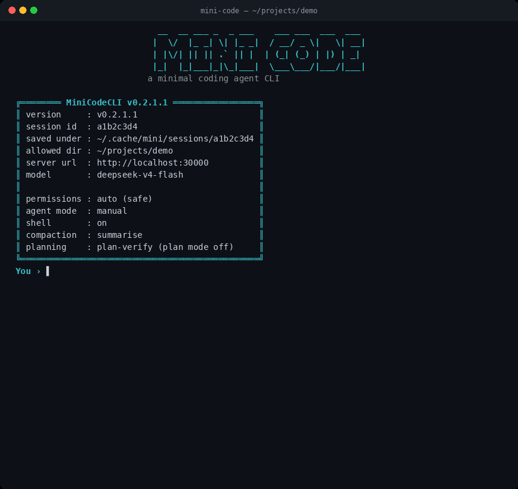

# mini-code-cli

### A minimal coding agent CLI

> No bloat, no dependencies, no tracking, no telemetry...

[](https://github.com/ai-nikolai/mini-code-cli/actions/workflows/ci.yml)
[](https://pypi.org/project/mini-code-cli/)
[](https://pypi.org/project/mini-code-cli/)
[](https://github.com/ai-nikolai/mini-code-cli/stargazers)
[](LICENSE)
[](#citation)



**Purpose:** a no-bloat, minimal coding CLI to enjoy experimenting and researching!

**Install** · [Quick start](#quick-start) · [Modes &amp; safety](#modes--safety) · [Options](#command-line-options) · [Tools](#available-tools) · [Sub-agents](#sub-agents) · [In-session commands](#in-session-commands) · [Development](#development) · [Docs](#documentation) · [Citation](#citation)

> [!TIP]
> **New here?** `pip install mini-code-cli`, point it at a model (a local server on
> `localhost:30000`, or `MINI_CODE_API_KEY` + `--url`), and run `mini-code`. Everything else
> is optional.

## Install

```bash
pip3 install mini-code-cli
```

- **PyPI:** <https://pypi.org/project/mini-code-cli/>
- **Python:** `>= 3.10` &nbsp;·&nbsp; **runtime dependency:** `requests` only
- **From source / contributing:** see [docs/README_DEV.md](docs/README_DEV.md)

## Quick start

**1 — Local model** (e.g. vLLM or SGLang on port 30000; see [serving a model locally](#serving-a-model-locally)):

```bash
mini-code                          # talks to http://0.0.0.0:30000/v1
```

**2 — Hosted / custom API:**

```bash
export MINI_CODE_API_KEY="sk-YOUR_API_KEY"
mini-code --url "https://api.deepseek.com" --model "deepseek-v4-flash"
```

**3 — The shortcuts** (plan mode, sub-agents, shell, auto-mode, no permission prompts):

```bash
mini-code --all                    # = --plan --enable-subagents --enable-shell --skills --auto-mode --sudo --background
mini-code --all-last               # ...and continue your last session
```

**4 — A first prompt:**

```txt
Write an agent.md file for me that helps an LLM write efficient triton kernels,
given a reference implementation.
```

> [!NOTE]
> **Every flag** is listed once, in [Command-line options](#command-line-options) — or run
> `mini-code --help`. Modes and their caveats are described in [Modes & safety](#modes--safety).

## Command-line options

| Option | Default | What it does |
| --- | --- | --- |
| `--url URL` | `http://0.0.0.0:30000` | API host |
| `--model MODEL` | — | model name |
| `--api-key KEY` | `$MINI_CODE_API_KEY` | API key for authentication |
| `--max-tokens N` | 32768, or half the model window | reply budget; also the output headroom used when deriving the compaction limit |
| `--temperature T` | `1.0` | sampling temperature |
| `--system-prompt TEXT` | built-in | replace the system prompt (an `--agent-md` file is appended *after* it) |
| `--prompt TEXT` | — | initial user prompt |
| `-a`, `--auto-mode` | off | keep querying the model and running tools until no tool calls remain |
| `--agent-md FILE` | — | append an `agent.md` file after the system prompt (e.g. `./skill.md`) |
| `--ask-permission` | off | ask before **every** tool call, including an ALLOW-tier shell command (`--sudo` disables all prompts) |
| `--sudo` | off | **dangerous:** never ask. DENY-tier commands are still refused |
| `--allowed-dir DIR` | `./` | sandbox for **file** tools (does not restrict the shell) |
| `-s`, `--enable-shell` | off | allow shell execution (classifier always applies) |
| `-g`, `--enable-subagents` | off | expose sub-agents as tools |
| `--background` | off | enable background shell/sub-agent tasks and the `background` tool; needs `--enable-shell` or `--enable-subagents` |
| `--tui [auto\|on\|off]` | `auto` | fixed full-screen dashboard. `auto` enables it only on a known interactive TTY; `on` forces it; `off` uses the scrolling console |
| `--skills` | off | enable the `.mini` skills directory (`skill.md`s, `SKILLS.md`, runnable scripts). **`run_skill` executes those Python scripts — arbitrary code execution, even without `--enable-shell`**; only enable it for a directory you trust |
| `-p`, `--plan` | off | plan mode (`CURRENT_GOAL.md` / `CURRENT_PLAN.md`, printed plan, `/plan`, `/skip-plan`) |
| `--super` | off | kitchen-sink behaviour preset: plan-verify2 + strict verification, all shell/sub-agent/skill/sudo/background features, auto-mode, prompt-change recovery and dynamic todos. The model, URL and API key are left untouched |
| `--plan-strategy NAME` | `plan-verify2` | `plan-verify2`, `plan-verify`, `plan-verify-step` or `open-plan` (implies `--plan`) |
| `--allow-nudge` | off | plan mode only: ask the model to continue (or reply DONE) when it stops without a tool call, before running the plan review |
| `--nudge-limit N` | 1 | maximum continuation nudges per text-only stop with `--allow-nudge` |
| `--strict-verify` | off | use the evidence-based verification prompt for every plan review/verify stage; also verifies after `open-plan` work settles. Unproven requirements count as unfinished |
| `--runtime-strategy NAME` | `normal` | `normal`, `prompt-change` or `prompt-change-plan`: recover after 3 consecutive failures of the same call/tool |
| `--scratchpad` | off | give the agent a free-form `.mini/SCRATCHPAD.md` (plus further scratch files) for thoughts, plans and learnings |
| `--dynamic-todo-tracking` | off | give the agent a structured session-local todo list (`todo_write` / `todo_update` / `todo_list`), independent of plan mode and the scratchpad |
| `--compaction-strategy NAME` | `summarise` | `summarise`, `predict-files` or `predict-messages` |
| `--llm-timeout S` | `500` | HTTP timeout for LLM requests |
| `--tool-timeout S` | `120` | timeout for a single tool call |
| `--max-context-tokens N` | derived | input-token budget before the history is compacted |
| `--cache-dir DIR` | `~/.cache/mini/sessions/` | where session histories are stored |
| `--no-settings` | off | do not load, prompt for, or save session settings (useful for CI/benchmark runs) |
| `--restore-session PATH` | — | continue a specific previous session |
| `-l`, `--load-last-session` | off | continue the session recorded in the `.mini` pointer |
| `--all` | off | `--plan --enable-subagents --enable-shell --skills --auto-mode --sudo --background` |
| `--all-last` | off | `--all` + `--load-last-session` |
| `--verbose` | off | print full detail (default: user/assistant turns, token usage, tool calls only) |
| `-h`, `--help` | — | show the built-in help |

## Available tools

The agent can call a small set of tools, all defined in `mini_code_cli/tools.py`. Every
parameter a model does not need is defaulted, so omitting it keeps the previous behaviour.

| Tool | What it does |
| --- | --- |
| `read_file` | read a file; `offset` (1-based line) and `limit` page through large files. Output is capped at 100k characters, so page or narrow instead of relying on a whole-file read |
| `write_file` | write/overwrite; `append` adds to the end, `create_dirs` creates parents |
| `edit` | replace an **exact** string (`old_string` → `new_string`); refuses a missing or ambiguous match unless `replace_all` |
| `grep` | regex search a file or directory; `recursive`, `include`, `ignore_case`, `line_numbers`, `max_results` (noise dirs skipped). Output is capped at 100k characters |
| `glob` | list files matching a glob (one per line, `**` supported), optionally against a `root`; capped at 2000 matches / 100k characters |
| `web_search` | DuckDuckGo Lite HTML search (POST), with DuckDuckGo Instant Answers and Wikipedia as fallbacks. Returns titles, URLs and snippets; never raises |
| `read_website` | fetch raw text/HTML of a **public http/https** URL (other schemes and private/link-local hosts are rejected; `MINI_CODE_ALLOW_PRIVATE_URLS=1` overrides); `max_chars` caps size |
| `run_shell_command` | run a shell command (needs `--enable-shell`); `cwd`, `timeout`, and stdout/stderr/exit code are all reported. Output over 50k characters is capped in the reply and the full text is written to `.mini/tool-output/` so `read_file`/`grep` can page it |
| `background` | start/list/output/wait/cancel background **shell** tasks (needs `--background --enable-shell`) or **sub-agent** tasks (needs `--background --enable-subagents`); output is captured in a per-task log |

## Sub-agents

`--enable-subagents` lets the main agent **delegate a focused task** to a sub-agent, exposed to
the model as an extra tool. A sub-agent is a self-contained, narrowed agent: it runs unattended
in auto-mode, in its own isolated session folder, and hands back a short text result (plus an
optional `report.md`). It reuses all the existing machinery — tools, the shell-safety
classifier, the `--allowed-dir` sandbox, compaction and `--plan` — and cannot spawn further
sub-agents.

```bash
mini-code --enable-subagents       # the available sub-agents then show up in /help
```

| Sub-agent | What it is for |
| --- | --- |
| `research` | read-only web research: searches, reads a few sources, returns a sourced summary. Can only use `web_search` / `read_website` — never the filesystem or shell. Optional `sources` hint (e.g. `"wikipedia.org only"`) |
| `planner` | drafts or refines a step-by-step plan for a goal; always runs in plan mode |
| `software_engineer` | writes, edits, refactors, fixes and tests code; can run shell commands (tests, builds) to verify |
| `generic` | general-purpose helper for anything that fits no narrower agent |

> [!NOTE]
> A sub-agent's `tools`, `enable_shell` and `max_steps` are always **intersected with the
> parent's** permissions, so it can never do anything the main agent could not. The `tools`
> allowlist is enforced on the nested session itself (both the schemas offered to the model and
> the dispatch table), not merely described in its prompt. Sub-agents compose with `--plan`:
> each keeps its own `CURRENT_PLAN.md` / `CURRENT_GOAL.md`.

<details>
<summary><b>Adding your own sub-agent</b></summary>

A sub-agent is just a small class — subclass `SubAgent` and register it:

```python
# my_subagents.py
from mini_code_cli.subagents import SubAgent, register

class SummarizeSubAgent(SubAgent):
    name = "summarize"
    description = "Summarize a piece of text the main agent provides."
    tools = ["read_file", "write_file"]   # restrict the nested agent's tools
    enable_shell = False
    max_steps = 5

register(SummarizeSubAgent())
```

Make sure the module is imported (e.g. `import my_subagents`) and it is discovered and exposed
to the model automatically when `--enable-subagents` is set. See
`mini_code_cli/subagents/builtin.py` for every knob and
[docs/ARCHITECTURE.md](docs/ARCHITECTURE.md) (sections 2–3) for the design.

</details>

## Background tasks

When `--background` is enabled together with shell execution or sub-agents, the agent also gets a `background` tool:

- `background(action="start", command="pytest -q")` starts a long command in its own process group;
- `background(action="start", kind="subagent", subagent="software_engineer", task="...")` starts
  a nested agent task;
- `list`, `output`, `wait` and `cancel` inspect or control the tasks.

Each task has an id (`bg-1`), a status, a log under the session folder
(`background/bg-1.log`), an output tail, and a cancellation path. Shell tasks are killed as a
process group; sub-agent tasks receive a cancellation event between steps. Background tasks are
session-local and do not survive a restart (the logs do).

Use `/background` to see the foreground activity and all tasks, or `/background bg-1` for one
task's output. Note that the main loop is synchronous, so `/background` can be typed between
steps; it shows the last/current blocking activity rather than live-during the call.

## In-session commands

| Command | What it does |
| --- | --- |
| `/history` | list the conversation (turn number, what happened, where) |
| `/history <n>` | show the full messages recorded for turn `n` |
| `/history last` | ...for the most recent turn |
| `/reset [<n>]` | rewind to the end of turn `n` (`last` works too); drops everything after it |
| `/clear` | clear the screen (keeps the conversation history) |
| `/plan` | show the current goal + plan (plan mode only) |
| `/todo` | show the dynamic todo list; `/todo clear` empties it |
| `/image <path>` | stage a PNG/JPEG/WEBP/GIF for the next message; `/image clear` removes staged images |
| `/context` | show how the context window is used: tokens and percentages by category (system prompt, user/assistant messages, tool calls/outputs, reasoning, overhead) |
| `/background [id]` | show foreground activity + background tasks, or one task's output tail |
| `/settings [name|number] [value]` | show or change session settings; bare `/settings` opens the settings prompt |
| `/expand [n]` | show the full detail of the nth most recent tool call (default: the last one) |
| `/skip-plan <prompt>` | send `<prompt>` once without generating or reviewing a plan |
| `/help` | show this help |
| `/quit`, `/exit` | save the session and exit |

**Multi-line input:** press `Shift+Enter` (or `Ctrl-J`) to insert a newline; plain
`Enter` sends the turn. This works in the session prompt and the startup tip
reminds you. Terminals that report `Shift+Enter` as a CSI-u/modifyOtherKeys
sequence are recognised; elsewhere `Ctrl-J` inserts the newline.

With `--tui`, mini-code switches to a fixed alternate-screen dashboard: a
**Mini-Code** summary box (version/session/model/context) at the top, a core
conversation view of user/assistant turns in the middle, and an input box with
a one-line help hint at the bottom. The whole screen is redrawn on changes, so the view never
scrolls; tool/thinking status is a transient line that disappears when the
operation finishes. `Shift+↑`/`Shift+↓` scroll the middle pane one line at a
time and show `(lines scrolled / total)`; `Esc` returns to the bottom or closes
command output (`/help`, `/history`, ...). Info/warnings sit below a small
separator at the bottom of the body. The dashboard is coloured when the
terminal supports it; info/warnings/errors are shown as coloured
`ℹ`/`⚠`/`✖`/`✔` lines. Each assistant block also carries a dim line with
that turn's tool calls, background tasks and assistant-message count.
Questions (resume/permission) use a yellow "Question to User" box just above
the input. Restored sessions load their history into
the core view and mark the summary as `[restored]`; generated plans append to
the core view. Tool details can be expanded with `/expand [n]`.

The prompt has a small line editor: `↑`/`↓` recall previous turns, `←`/`→` move
the cursor, Home/End jump within the line, and `Ctrl-A/E/K/U/L` provide the
usual editing/clear shortcuts. `--tui` defaults to `auto` (known TTY only); use `--tui=off` for the old
scrolling console or `--tui=on` to force it. It is not part of `--all`.

> [!NOTE]
> `/history` and `/reset` are driven by `summary_history.json`, a flat recorder that maps every
> turn to the `history_{n}.json` segment and message index it lives in — so no full history is
> read just to list the conversation.
>
> * **`<n>` is validated**: `last`, or a positive 1-based turn number. `0`, negatives and
>   non-numbers are rejected with `No such turn` instead of silently showing a different turn.
> * **A bare `/reset` never destroys anything**: it reports `Already at turn N` when the
>   transcript already ends at the last recorded turn, and *warns instead of truncating* if
>   there are messages that were never recorded. Only `/reset <n>` / `/reset last` rewind.
> * **A rewind really sticks**: the target `history_{n}.json` is truncated in place (no backup)
>   and every higher `history_{m}.json` / `usage_{m}.json` segment is deleted, so a restart
>   cannot resurrect the dropped turns. All history files are written atomically.
> * **Token usage is never rolled back**: a rewind does not un-spend tokens, and the session
>   total is preserved. See
>   [docs/ARCHITECTURE.md](docs/ARCHITECTURE.md#rewinding-reset-and-what-it-does-to-the-files)
>   for the files involved.

### Session settings

Settings are stored per session in the cache, never in the project’s `.mini`:

```text
<cache-dir>/<session-id>/settings.json
```

The file has a single current layout (`version`, `values`, `api_keys`,
`api_key_envs`, with keys scoped by endpoint/model); older top-level key fields
are ignored rather than migrated. Startup deliberately does **not** load
previous-session settings: the resume offer
uses the CLI/environment/default configuration, so no settings notes or questions
appear before you choose. Settings are loaded only after that choice. Resuming
adopts the restored session’s settings; starting a **new** session resets ordinary
settings to their defaults (the previous per-model API-key archive is the one thing
kept) and asks the provider/model questions again, pre-selecting the current provider
so Enter keeps it. An explicit `--model` skips the questions. The saved model and API
key are checked after the model is known (after the restore, or after the
provider/model selection).

The wizard asks for the model provider (`localhost`, `deepseek`, or a custom URL)
and, when needed, the API key. For DeepSeek it then asks which model to use, offering
the ids from the live `/v1/models` response when a key is available (otherwise the
stable `deepseek-chat` / `deepseek-reasoner` aliases). The DeepSeek key prompt says
where to create a key and that `MINI_CODE_API_KEY` is used first. When the fixed TUI
applies, the wizard runs inside it (arrow keys or numbers select, and a typed key is
masked). If you type a key, mini-code asks clearly whether to write it to the session
file with mode `0600`; otherwise it stays in memory for this session only. Keys are
scoped to the endpoint/model: selecting another model loads its stored key, or asks
for one when none is stored. Once the model is known, a key found for it is checked
against `/v1/models`; an explicit `401`/`403` rejection reopens the key prompt.

Use `/settings` to inspect or change settings. The table marks values that rebuild
the tool list or generated system prompt — these invalidate the LLM prompt cache.
Cache-impacting edits from the plain `settings>` prompt are staged until you type
`apply`, so a batch rebuilds the prompt once.

In the fixed TUI the centered, unboxed ASCII mark and tagline (the same mark used by
`--tui off`) sit above the session view and stay visible in the settings views. The
settings table is a navigable overlay grouped into Model & connection, Generation,
Planning, Compaction, Tools & permissions, Runtime limits, Display, Agent behaviour
and Immutable/session sections (so e.g. `verbose` lives under Display). It starts at
the first setting and scrolls with the selection. Up/down or numbers select;
left/right toggle an on/off setting or rotate through a fixed-choice setting
(such as `plan-strategy`) in place. Values equal to their built-in default are marked
`(default)`. Enter opens a focused sub-window that shows only that setting's input
box (or its option list), where `exit` or Esc returns to the settings table. The full
table (including immutable rows) is always shown. `a` stages the same feature flags
as the CLI `--all` preset (plan, shell, sub-agents, skills, auto-mode, sudo,
background); `p` stages the CLI `--super` preset; `d` stages all defaults while
keeping the model, URL and API key. The
same presets are
available as `/settings all`, `/settings super` and `/settings default`. Changes are staged in the
table until you press `s` to save; `q` quits, and if there are unsaved changes it
asks whether to save them or cancel the changes. The table header shows a green
`saved` or yellow `unsaved` badge. Plan
mode is its own on/off setting;
the plan strategy keeps a concrete value even while plan mode is off, and changing
the strategy does not turn plan mode on. Changing the TUI, paths, the custom system
prompt or the initial prompt is not allowed mid-session.

## Development

Linting, the test suite, CI and the release process are documented in
[**docs/README_DEV.md**](docs/README_DEV.md).

```bash
python3 scripts/lint.py                                # lint (standard library only)
python3 -m unittest discover -s tests -p "test_*.py"    # run the test suite
```

Releases are cut by tagging `main`: pushing a `v*` tag triggers
[`.github/workflows/release.yml`](.github/workflows/release.yml), which builds the sdist + wheel,
verifies them with `twine check`, and attaches them to a new GitHub release.

## Documentation

Everything beyond this README lives in [`docs/`](docs/):

| Document | What it covers |
| --- | --- |
| [**docs/README_DEV.md**](docs/README_DEV.md) | developer guide — local setup, repository layout, linting, the test suite, CI and the release / PyPI upload process |
| [**docs/ARCHITECTURE.md**](docs/ARCHITECTURE.md) | design — module layout, on-disk conversation state (`history_{n}.json`, `summary_history.json`, usage files), the sub-agent framework and how to extend it |

This README stays the user-facing entry point (install, CLI flags, tools, sub-agents,
in-session commands, modes &amp; safety); the two documents above go deeper on the developer
and design side.

## Modes & safety

### Shell execution — `-s` / `--enable-shell`

Everything the agent runs from the shell first passes a **safety classifier** that sorts the
command into one of three tiers:

| Tier | Examples | What happens |
| --- | --- | --- |
| **DENY** | `rm -rf /`, `dd of=/dev/...`, `mkfs.*`, fork bombs | refused outright, never run |
| **ASK** | `rm file`, `sudo ...`, `chmod`, `curl ... \| sh` | requires your confirmation |
| **ALLOW** | `ls`, `cat`, `git status` | runs without prompting |

`--sudo` removes the confirmation prompts (ASK tier and `--ask-permission`); DENY commands are
still refused. With no flags, an ASK-tier command prompts and an ALLOW-tier one runs unaided.

> [!WARNING]
> The classifier is **always enforced** — even in auto-mode and with `--sudo` — so the agent
> cannot run destructive commands unattended. It is a heuristic, not a sandbox: use it with care.
> `--allowed-dir` sandboxes **file tools**, not the shell.

### Plan mode — `-p` / `--plan`

The loop keeps two human-readable tracking files in the session directory: `CURRENT_GOAL.md`
(your latest instruction) and `CURRENT_PLAN.md` (a step-by-step plan for that goal, marked
finished when it is done). They are authored by the *loop*, not the agent, live outside
`--allowed-dir`, and can be inspected any time with `/plan`. The generated plan is
also printed as a box right after planning, so you can see it without asking.
Use `/skip-plan <prompt>` to send one prompt without planning it (plan mode stays
on for later turns).

`--plan-strategy` selects how planning is wired:

| Strategy | What happens |
| --- | --- |
| `plan-verify2` (default) | Author a plan, then verify completion with one machine-readable verdict (`STATUS: DONE` / `STATUS: INCOMPLETE` / `STATUS: IN PROGRESS`). `DONE` ends the turn immediately, without the post-review step; an unfinished verdict re-queues the outstanding work and the agent continues, with another verify after it settles. |
| `plan-verify` | Author a plan, review it once the work settles, then keep the post-review step only when it calls a tool. A no-tool answer is shown to you and ends the turn without being appended to the transcript. |
| `plan-verify-step` | The original behaviour: same plan + review, then always run one extra step and keep whatever that step says. |
| `open-plan` | The agent owns a plan document at `.mini/PLAN.md` inside `--allowed-dir`, reads and updates it with the normal file tools, and the loop neither authors nor reviews a plan. |

> [!NOTE]
> Plan mode also changes **history compaction**: after the transcript is compacted to a summary,
> `CURRENT_PLAN.md` and `CURRENT_GOAL.md` are re-injected, so the agent keeps working against the
> same goal. With `open-plan`, the agent's `.mini/PLAN.md` is re-injected instead. When the work
> looks done the plan is reviewed (or, with `plan-verify2`, verified with a DONE/INCOMPLETE
> verdict) and any outstanding task is re-queued before the agent returns to you (except with
> `open-plan`, unless `--strict-verify` is on).

`--strict-verify` makes the completion check evidence-based instead of trust-based. The verifier
must restate the goal as concrete requirements, cite the tool call/output that proves each one, and
mark missing or ambiguous evidence as unfinished. It applies to `plan-verify`, `plan-verify2` and
`plan-verify-step`, and with `open-plan` it adds a verification pass after the work settles without
taking ownership of the agent's plan document.

`--allow-nudge` adds a completion checkpoint to any plan strategy. When the model replies without
a tool call and the text does not explicitly say `DONE` / complete / finished, the loop appends a
short “continue with the next tool call, or reply DONE” message instead of immediately paying for a
plan review. `--nudge-limit N` controls how many nudges are allowed per text-only stop (default 1).
After the limit, the normal plan strategy takes over. This is useful for thinking models that tend
to emit an intermediate “let me do X” message and stop.

### Runtime recovery — `--runtime-strategy`

The runtime strategy decides what happens when tool use keeps failing. It is independent of plan
mode and applies to every turn:

| Strategy | What happens |
| --- | --- |
| `normal` (default) | No automatic prompts; the model sees tool errors and decides. |
| `prompt-change` | After three consecutive failures of the same call (same command/path/query) or of the same tool with different inputs, the loop injects: “You have tried TOOL N times and it failed. Rethink your approach and try something else.” It also shows the last failure. A success resets the streak; at most three prompts are issued per turn. |
| `prompt-change-plan` | The same prompt, then a fresh planning request for the current goal. In `open-plan` the loop injects the recovery plan but does not overwrite the agent's `.mini/PLAN.md`. |

Both recovery strategies are heuristics: they are meant to break repetitive command/tool loops
without changing the model's overall instruction. When `web_search`/`read_website` are available,
the prompt also tells the model to search the documentation or the web before retrying.
`runtime-strategy` and `strict-verify` are also available in `/settings`.

### Dynamic todo tracking — `--dynamic-todo-tracking`

This is separate from the scratchpad. It registers three structured tools and tells the agent to
keep a short checklist:

- `todo_write` replaces the list with a JSON array of `{"content", "status"}` objects;
- `todo_update` changes one item by id (`pending`, `in_progress`, `completed`);
- `todo_list` shows the current list.

The store is session-local (`<cache-dir>/<session-id>/todos.json`), not a project file, so it does
not pollute the worktree or a benchmark's filesystem checks. `/todo` shows it and `/todo clear`
empties it. A scratchpad remains useful for free-form notes; the todo list is for tracked,
verifiable steps.

### Images — `/image` and image-aware `read_file`

`/image PATH` stages a PNG/JPEG/WEBP/GIF for the next user message. The file is copied into the
session cache and the conversation stores a small reference, not base64; the bytes are resolved
into a data URI only when the request is built. `/image clear` drops staged images.

The agent's `read_file` is also image-aware: reading a supported image attaches it as an image
content block after the tool result. `read_file` still handles text as before. Images count toward
the context estimate and are flattened to `[image: name]` in plan/review/compaction prompts.

### Scratchpad — `--scratchpad`

With `--scratchpad`, the loop creates `.mini/SCRATCHPAD.md` inside `--allowed-dir` and tells the
agent that it may read and write that file freely, and may create additional scratch files in the
same directory (for example `SCRATCH-NOTES.md`, `SCRATCH-IDEAS.md`). The scratchpad is ordinary
state inside the sandbox, so the normal `read_file` / `write_file` / `edit` tools work; no special
tool is registered. It is meant for the agent's own thoughts, plans, learnings and open questions,
and survives a history compaction because it lives on disk.

### Sessions — resume, or start fresh

Every session is saved under `--cache-dir` (default `~/.cache/mini/sessions/`).

> [!TIP]
> If a previous session exists but you did **not** ask to resume one (neither
> `--load-last-session` nor `--restore-session`), the prompt offers **Resume / Start new / Exit**
> before the conversation begins. Ctrl-C or EOF there is a graceful exit. This is the *asking*
> variant; `--load-last-session` is the *silent* one.


| Flag | Behaviour |
| --- | --- |
| `--restore-session PATH` | continue that exact session (a session directory or a bare session id under `--cache-dir`) |
| `-l`, `--load-last-session` | continue the session recorded in the `.mini/last_session.json` pointer, without asking |

`--load-last-session` continues that session **in place** (same id, same folder, same
messages), so the conversation you were in is the one you get back; an explicit
`--restore-session` wins if both are given. The "most recent" session comes from a single
source — the tiny `.mini/last_session.json` pointer written when a session starts or is
restored inside `--allowed-dir` (deliberately no timestamp fallback: with no pointer, a fresh
session starts). That pointer lives in the same `.mini` directory as `--skills`, but as its
own dedicated file, so the two never clash.

A session folder is restorable only if it has what this version writes: a valid
`summary_history.json` recorder, plus the `history_{n}.json` segment its last record names
(usage files are optional). Anything else — a folder from an older release, a hand-assembled
transcript, a recorder that does not validate, a missing segment — is **refused with a note
saying why**, and a fresh session is started instead. Nothing is repaired, guessed at, or
written into the refused folder.

### Context compaction — `--max-context-tokens`

Compaction is decided by **tokens only**, never by message count: a few large tool outputs can
fill a window that hundreds of short turns would not. The next request is projected from the
server-reported `prompt_tokens`, plus an estimate of what was appended since, plus the output
reserve (`--max-tokens`). Unset (default) it is derived from the model's context window minus the
output reserve and a safety margin. Lower it to compact sooner, raise it to compact later — there
is no message-count cap to configure.

Compaction replaces the older turns with a summary, but it always carries the **turn in flight**
across the rollover: the message you just typed (or, mid-turn, the tool call the model is
waiting on) is kept verbatim after the summary. So a compaction that fires just as you send an
instruction cannot swallow it — the model still answers what you asked, and the turn stays in
the session file, in `/history` and in a later restore.

`--compaction-strategy` chooses what else survives besides the summary:

| Strategy | Messages after compaction |
| --- | --- |
| `summarise` (default) | `system`, `summary`, `plan`, `current turn` |
| `predict-files` | `system`, `summary`, predicted read-only tool calls + results, `plan`, `current turn` |
| `predict-messages` | `system`, `summary`, original messages the model names by index, `plan`, `current turn` |

`predict-files` asks the model which files it needs to re-read and executes only the read-only
tools (`read_file`, `grep`, `glob`) it predicts; `predict-messages` asks for a JSON array of
0-based message indexes to keep verbatim. Both predictions are one extra tool-free (or
read-only-tool) LLM call, are billed normally, and are capped so they cannot refill the context
they just freed. A failed prediction degrades to the plain summary.

Because a rollover leaves no trace in the transcript (the old turns really are gone), the
console says in plain terms what happened — all of it without `--verbose`:

```
[!] Compacting the conversation: 42 messages -> a summary (51000 tokens in, 32768 reserved for the reply > 60000 budget). The current turn (1 message) is kept verbatim.
[!] Summary preview: The user asked for a token-based compaction trigger, then fixed ...
[!] Compacted history_0.json (42 messages) into a summary; history_1.json now starts with 3 messages (summary + 1 kept message).
```

So you can see *what* was folded away (a preview of the summary itself), *how much* (the
message count of the segment that was closed), *where it went* (`history_0.json` closed,
`history_1.json` started) and that nothing you just typed was lost. The summary request is
itself size-bounded, so a single enormous tool output cannot make compaction overflow the
model's context window. If the summariser answers with an empty summary twice, or the call
fails, compaction falls back to a deterministic mechanical summary (the goal plus the newest
turns) and still rolls the segment over — keeping the over-long transcript would make every
later request fail.

### Exiting — the good-bye box

Quitting (`/quit`, `exit`, or EOF on stdin) saves the session, prints the centered
yellow Mini Code mark and tagline above the box, and then prints a short content-width
yellow box: the version, a sign-off, and what the session left behind — session id,
model, folder, the history segments on disk, how many turns were recorded, run duration,
token / call totals, background tasks cancelled on exit, and a `--load-last-session`
resume hint.

```
                  __  __ ___ _  _ ___    ___ ___  ___  ___
                 |  \/  |_ _| \| |_ _|  / __/ _ \|   \| __|
                 | |\/| || || .` || |  | (_| (_) | |) | _|
                 |_|  |_|___|_|\_|___|  \___\___/|___/|___|
                a minimal coding agent CLI

╔══════════ MiniCodeCLI v0.1.1.2 - goodbye ═════════════════════╗
║ Goodbye, and thanks for using MiniCodeCLI!                    ║
║                                                               ║
║ session id   : 1792666273983619-36ca3c2e                      ║
║ model        : ornith-ai/Ornith-1.5-35B-A3B                   ║
║ saved under  : ~/.cache/mini/sessions/1792…-36ca3c2e/         ║
║ history      : history_0.json (segment 0), 5 messages         ║
║ conversation : 2 recorded turns                               ║
║ duration     : 12m 34s                                        ║
║ tokens       : 20 in / 10 out (30 total)                      ║
║ calls        : 2 LLM, 0 tool                                  ║
║ background   : none running                                   ║
║ resume       : mini-code --load-last-session                  ║
╚═══════════════════════════════════════════════════════════════╝
```

It is printed exactly once, and only on a normal exit: a Ctrl-C or an internal error already
says what went wrong in red, so it does not get a cheerful summary box on top. With `--verbose`
the old per-field `Token usage (this session)` block is printed above it as well.


## Benchmarks (academic evaluation)

`benchmarks/` runs coding agents against **Terminal-Bench 2.x** and **SWE-bench Verified** and
compares them: mini-code with several settings, Claude Code, Pi, plus a deterministic `mock`
agent for plumbing checks. It is an orchestration layer, not a reimplementation — every
benchmark is executed by its own official harness (`harbor` for Terminal-Bench 2.x, `tb` for the
1.x core datasets, `swebench.harness.run_evaluation` for SWE-bench), and every agent is driven
through its own CLI.

Install the optional dependencies (never part of the CLI's own install):

```bash
python -m pip install -r requirements-bench.txt   # terminal-bench, swebench, vllm, litellm
```

```bash
python -m benchmarks list                      # suites, agents, settings
python -m benchmarks validate -c benchmarks/configs/default.json
python -m benchmarks plan   -c benchmarks/configs/default.json --limit 1   # dry run: prints commands
python -m benchmarks prepare -c benchmarks/configs/default.json --suite swebench
python -m benchmarks run    -c benchmarks/configs/default.json --run-id my-run
python -m benchmarks report --run benchmarks/runs/my-run
python -m benchmarks models -c benchmarks/configs/default.json             # vLLM / LiteLLM commands
```

| Piece | Where | Notes |
| --- | --- | --- |
| configs | `benchmarks/configs/` | `default.json` (two suites, four agents), `mini_code_settings.json` (the setting matrix), `offline.json` (no keys, no network) |
| mini-code settings | `benchmarks/agents/mini_code.py` | `default`, `auto-shell`, `plan`, `subagents`, `skills`, `long-context`, `short-tool-timeout`, `all` |
| artifacts | `benchmarks/runs/<run-id>/` | `manifest.json` (git SHA, dataset, docker digests), per-trial `trial.json` + `logs/`, `results.jsonl`, `summary.{json,md}` |

Two things to know before running anything:

* **`plan` is the default way to look at a run.** It prints the exact argv (never a shell
  string), the environment variable *names* it sets and the Docker calls, without downloading a
  dataset or starting a container.
* **Agent execution is refused outside a container** unless `--allow-host` is passed: several
  settings (`--sudo`, `bypassPermissions`) are only safe in a disposable environment. Logs,
  results and summaries are written with credential values redacted.

Claude Code speaks the Anthropic Messages API only, so a local model needs the LiteLLM proxy
(`benchmarks/models.py`) in front of vLLM, while mini-code and Pi can use the OpenAI-compatible
endpoint directly (`benchmarks/configs/pi_models.json` shows Pi's provider entry).

Terminal-Bench 2.x runs through `harbor` (`harbor run -d terminal-bench@2.1 ...`); Claude Code
and Pi are harbor's own agents there, while mini-code goes through the installed-agent bridge in
`benchmarks/harbor_agents.py`. Set `options.harness` to `"tb"` on the suite to run the older
`terminal-bench-core` task sets with the `tb` CLI and the `benchmarks/tb_agents.py` bridge.
Because harbor is young and fast-moving, start with `plan` and a single `--limit 1` trial.

## Serving a model locally

For a one-GPU quick start, `scripts/run_model.sh` starts the small
`ornith-ai/Ornith-1.5-35B-A3B` checkpoint on port 30000 and waits for `/health`.
Edit its model/tensor-parallel line for a larger checkpoint. Tested with vLLM
v0.30 (tool calling enabled):

```bash
vllm serve ornith-ai/Ornith-1.5-397B-FP8 \
    --tensor-parallel-size 4 \
    --host 0.0.0.0 \
    --port 30000 \
    --enable-auto-tool-choice \
    --tool-call-parser qwen3_xml \
    --reasoning-parser qwen3 \
    --trust-remote-code
```

## Citation

If you use `mini-code-cli` in your research or writing, please cite it:

```bibtex
@misc{mini-code-cli,
  author       = {Rozanov, Nikolai},
  title        = {mini-code-cli: A minimal, dependency-light coding agent},
  year         = {2026},
  version      = {0.3.0.0},
  howpublished = {\url{https://github.com/ai-nikolai/mini-code-cli}},
  note         = {A no-bloat, dependency-light agent CLI for experimenting.}
}
```

## License

[AGPL-3.0](LICENSE) — (C) Nikolai Rozanov, 2026 – present.
